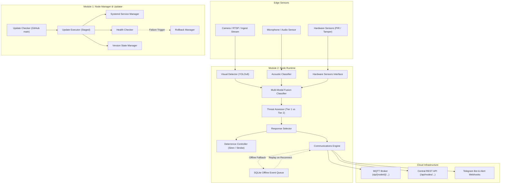
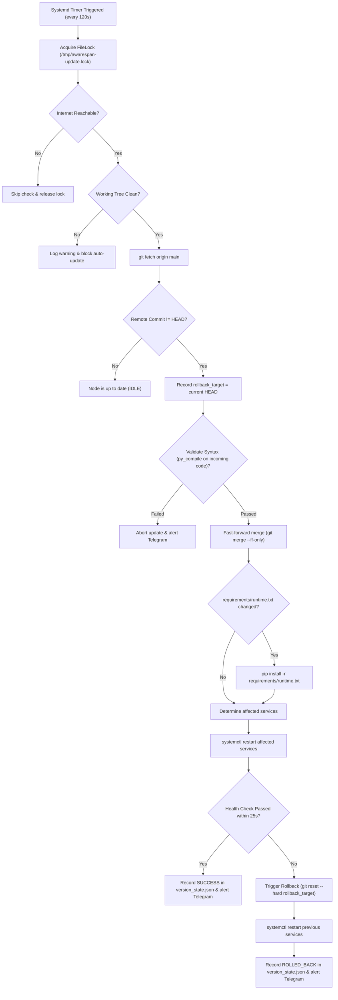

# AWARESPAN — Node Core Processing

> **Tagline:** Awareness Without Boundaries.  
> **Official Problem Statement:** An AI-Powered Safety Device.  
> **Project Contact:** awarespan@bchbenjamin.in  
> **Repository:** [https://github.com/awarespan/node-core-processing](https://github.com/awarespan/node-core-processing)

Edge node core processing, autonomous lifecycle manager, and threat assessment engine for the **AWARESPAN** platform. Connects real-time video/audio sensor streams to the Raspberry Pi 5 Edge Compute Core running YOLOv8 threat detection, two-tier deterrence logic, cloud MQTT/REST synchronization, durable offline event queueing, and safe automated git updates.

---

## 1. Modular Architecture Overview

The codebase is organized into **three independently managed subsystems** within a single repository:

```
node-core-processing/
├── node_manager/           # Module 1: Lifecycle, auto-updates, rollback & health verification
│   ├── updater/            # Update checker, staged executor, rollback & version state
│   ├── service_manager.py  # Systemd controller and selective restart resolver
│   ├── health_check.py     # Bounded runtime diagnostic probes
│   └── cli.py              # Unified CLI: status, check, update, rollback, health
│
├── node_runtime/           # Module 2: Production edge runtime (NO training code)
│   ├── detection/          # Visual (YOLOv8), acoustic, and hardware sensor interfaces
│   ├── processing/         # Classifier, two-tier threat assessment, response selector
│   ├── deterrence/         # Siren (aplay) audio deterrence and strobe triggers
│   ├── communications/     # MQTT client, REST fallback, SQLite offline event queue
│   ├── monitoring/         # Hardware power monitor & interactive Telegram bot
│   └── main.py             # Production runtime entry point
│
├── ml_pipeline/            # Module 3: Model training & evaluation (DISABLED on nodes)
│   ├── datasets/           # Dataset registry, download/merge, audit & deduplication
│   ├── training/           # Autonomous training orchestrator, checkpoint resume & OOM fallback
│   ├── evaluation/         # Batch video/audio evaluation
│   └── packaging/          # Model artifact packaging & metadata generator
│
├── shared/                 # Common utilities across all subsystems
│   ├── config/             # Canonical root .env discovery and typed settings
│   ├── logging/            # Centralized logger with automatic credential scrubber
│   ├── models/             # Shared dataclasses (events, detections, heartbeats, state)
│   └── utilities/          # FileLock, hardware inspection (Pi throttled flags), safe subprocess
│
├── deployment/             # Systemd service & timer unit templates and sudoers policy
│   ├── systemd/            # awarespan-updater, awarespan-node, awarespan-power-monitor, etc.
│   └── sudoers/            # Passwordless systemctl permissions for non-root auto-updater
│
├── scripts/                # Operator CLI & deployment scripts
│   ├── install.sh          # Idempotent installer (virtualenv, deps, systemd)
│   ├── uninstall.sh        # Clean uninstaller (--purge support)
│   ├── update.sh           # Manual update trigger CLI
│   ├── rollback.sh         # Manual rollback trigger CLI
│   └── status.sh           # Full diagnostic status CLI
│
└── requirements/           # Segregated dependency boundaries
    ├── runtime.txt         # Production node runtime dependencies
    ├── training.txt        # Dedicated ML training dependencies
    └── dev.txt             # Testing & linting dependencies
```

---

## 2. System Architecture Diagram



---

## 3. Automatic Update Lifecycle Diagram

Production nodes poll the `main` branch on GitHub (default interval: 120s via `awarespan-updater.timer`). Updates are applied atomically without human intervention:



---

## 4. Installation & Deployment

### Quick Install on Raspberry Pi
From repository root on the Pi:
```bash
./scripts/install.sh
```

The installer will:
1. Validate hardware and Linux prerequisites.
2. Create runtime directories (`/var/lib/awarespan`, `/var/log/awarespan`, `/var/lock/awarespan`).
3. Set up the Python virtual environment and install `requirements/runtime.txt`.
4. Deploy systemd units to `/etc/systemd/system/`.
5. Configure passwordless service restart permissions for the auto-updater in `/etc/sudoers.d/awarespan`.
6. Enable and start `awarespan-updater.timer`, `awarespan-node.service`, and `awarespan-power-monitor.service`.

### Uninstallation
```bash
# Clean service uninstallation
./scripts/uninstall.sh

# Complete purge including state and logs
./scripts/uninstall.sh --purge
```

---

## 5. Operations & CLI Reference

### Check Diagnostic Status
```bash
./scripts/status.sh
```
Displays node identity, hardware model, current git commit, tracking branch, updater status, CPU temperature, undervoltage throttled status, and active systemd services.

### Manual Update Check
```bash
python3 -m node_manager.cli check
```

### Trigger Update Immediately
```bash
./scripts/update.sh
```

### Trigger Manual Rollback
```bash
# Roll back to the automatically recorded rollback target:
./scripts/rollback.sh

# Or roll back to an explicit commit SHA:
./scripts/rollback.sh --commit 5f4b005d
```

### Run Subsystem Health Probe
```bash
python3 -m node_manager.cli health
```

---

## 6. Model Training Policy

**Model training is strictly disabled by default on production edge nodes (`ML_TRAINING_ENABLED=false`).**

Production nodes perform real-time video ingestion, YOLO inference, threat assessment, deterrence siren playback, and telemetry publishing. Model training is executed on dedicated workstations or explicitly enabled environments:

```bash
# Dedicated training run (from workstation with GPU/CPU):
python3 -m ml_pipeline.training.train_autonomous --epochs 100 --batch 4 --force

# Packaging trained weights into versioned deployment artifacts:
python3 -m ml_pipeline.packaging.model_packager --weights runs/detect/train/weights/best.pt --name yolov8n_best_weapon --version 1.1.0
```

---

## 7. Interactive Telegram Bot

Production nodes feature an interactive Telegram Bot for remote telemetry and field threat testing:
- `/status` — View node CPU temperature, throttled flags, and connectivity.
- `/threats` — Display active Tier 1 and Tier 2 classification policies.
- `/health` — Run bounded diagnostic probes.
- **Photo Threat Test:** Send any photo directly to the bot. The node downloads the image, runs YOLOv8 weapon detection, annotates bounding boxes, classifies threats, and replies to the chat with the marked photo and threat decision.
