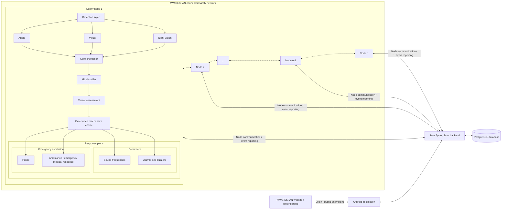

# CONTEXT.md — AWARESPAN
### Master Project, Academic and Engineering Reference
**Project name:** AWARESPAN  
**Tagline:** Awareness Without Boundaries.  
**Official problem statement:** An AI-Powered Safety Device.  
**Last updated:** 11 November 2026 | **Maintained by:** B C H Benjamin (Team Lead)

---

## TABLE OF CONTENTS

1. [Project Identity and AWARESPAN Branding](#1-project-identity)
2. [Team Details](#2-team-details)
3. [Academic & Institutional Context](#3-academic--institutional-context)
4. [Problem Statement](#4-problem-statement)
5. [SDG Alignment](#5-sdg-alignment)
6. [Field Visit & Stakeholder Research](#6-field-visit--stakeholder-research)
7. [Literature Survey Summary](#7-literature-survey-summary)
8. [System Architecture](#8-system-architecture)
9. [Hardware Implementation Plan](#9-hardware-implementation-plan)
10. [AWARESPAN Branding Rollout Across Components](#10-awarespan-branding-rollout-across-components)
11. [Software & ML Stack](#11-software--ml-stack)
12. [Software Engineering Model](#12-software-engineering-model)
13. [Research Paper Status](#13-research-paper-status)
14. [References](#14-references-all-13)
15. [Datasets](#15-datasets)
16. [GitHub Repositories for Prototyping](#16-github-repositories-for-prototyping)
17. [Autonomous Edge Training Pipeline](#17-autonomous-edge-training-pipeline)
18. [Batch Processing Pipeline](#18-batch-processing-pipeline)
19. [Telegram Bot Integration](#19-telegram-bot-integration)
20. [Deliverables Completed](#20-deliverables-completed)
21. [Open Items & Next Steps](#21-open-items--next-steps)

> Historical academic and implementation notes are retained below where useful. Dates, dataset counts, model metrics, hardware prices, training settings and completion claims are snapshots from the original source document and must be revalidated before being presented as current.

---

## 1. Project Identity

| Field | Value |
|---|---|
| **Project Title** | AWARESPAN |
| **Short Title** | An AI-Powered Safety Device |
| **ASIP ID (Old)** | ASIP_127 |
| **ASIP ID (New)** | 24UTAI13 |
| **Semesters Active** | Semester 3 (2024–25), Semester 4 (2025–26), continuing to Semester 8 |
| **Primary SDG** | SDG 12: Law Enforcement & Governance |
| **Secondary SDGs** | SDG 6: Disaster Management & Emergency Services; SDG 8: Urban Structure & Transportation |
| **Institution** | Atria Institute of Technology (An Autonomous Institution), Bengaluru – 560024 |

---

### AWARESPAN Brand and Project Identity

AWARESPAN is the public-facing name of the project and its evolving technology platform.

- **Name:** AWARESPAN
- **Meaning:** AWARE + SPAN — extending awareness across environments, locations, connected devices and communities.
- **Tagline:** **Awareness Without Boundaries.**
- **Official problem statement:** **An AI-Powered Safety Device.**
- **Official contact email:** [awarespan@bchbenjamin.in](mailto:awarespan@bchbenjamin.in)
- **GitHub organisation/account:** https://github.com/awarespan
- **Landing-page repository:** https://github.com/awarespan/awarespan

The brand describes a connected safety technology platform combining sensing, edge intelligence, threat assessment, proportionate response, connected nodes and human oversight. It must not be positioned as only a CCTV product, weapon detector, Raspberry Pi project or conventional surveillance system.

**Naming convention:** Use **AWARESPAN** in public-facing product, website, app, documentation, presentation and repository branding. Retain **ASIP** only when referring to the college course/programme. Retain **SIP** only when explaining historical repository names, legacy code identifiers or the project's former internal name; do not use it as the current public brand.

**Branding rollout decision:** AWARESPAN is the canonical identity across the full project ecosystem, including the landing page, Android application, backend/API presentation, edge-node software interfaces, dashboards, documentation, release artifacts, repository descriptions and academic presentation materials. These are the required branding targets; this context update records the decision and does not claim that every codebase, app binary, deployment, domain, store listing or repository has already been changed. Separate implementation tasks/prompts will update those components.

### Repository and Domain Ownership

The project is moving from a single monorepo workflow to separately maintained repositories under the AWARESPAN GitHub account/organisation.

- **Landing page repository:** https://github.com/awarespan/awarespan
- **Official project email:** awarespan@bchbenjamin.in
- **GitHub namespace:** `awarespan`

The landing-page repository is the canonical home for the public website. Do not assume the old monorepo remains the canonical home for all future components. Component repositories should be linked only after their exact repository URLs are confirmed.

**Domain policy — do not invent or silently rename domains:**

| Purpose | Current known hostname / URL | Treatment |
|---|---|---|
| Personal/domain email namespace | `bchbenjamin.in` | Existing domain; official project mailbox is `awarespan@bchbenjamin.in`. |
| Backend API | `https://api.sip.bchbenjamin.in/` | Existing project API hostname recorded in prior release/deployment material. Preserve until a deliberate DNS, TLS, hosting and client-configuration migration is completed. |
| AI gateway | `https://ai.bchbenjamin.in` | Separate AI gateway project endpoint; not the AWARESPAN public website or backend API. Do not relabel it as an AWARESPAN domain. |
| Public AWARESPAN website | Not confirmed in this context | Use the GitHub repository URL until the production domain is explicitly confirmed. Do not infer `awarespan.bchbenjamin.in` or any other hostname. |

When a custom AWARESPAN website/API domain is selected, update DNS, TLS certificates, hosting configuration, CORS allowlists, OAuth/deep links where applicable, Android API configuration, backend environment variables, email/contact links, SEO metadata and documentation together. Do not change the API hostname merely to make its name match the new brand; domain migration is a separate coordinated engineering task.

---

## 2. Team Details

### Team Lead
| Field | Value |
|---|---|
| **Name** | B C H Benjamin |
| **LinkedIn** | [bchbenjamin](https://www.linkedin.com/in/bchbenjamin/) |
| **USN** | 1AT24CS037 |
| **Department** | Computer Science Engineering (CSE) |
| **Section** | A |
| **Phone** | [not retained] |
| **Email** | 1AT24CS037@atria.edu |

### Team Members
| # | Name | LinkedIn | USN | Dept | Section | Phone | Email |
|---|---|---|---|---|---|---|---|
| 2 | Saniya J | [saniya-j-saniya-44b656355](https://www.linkedin.com/in/saniya-j-saniya-44b656355/) | 1AT24CS186 | CSE | C | [not retained] | 1AT24CS186@atria.edu |
| 3 | Chetan S | — | 1AT24EC031 | ECE | A | [not retained] | 1AT24EC031@atria.edu |
| 4 | Aydin Hasan K S | — | 1AT24EC017 | ECE | A | [not retained] | 1AT24EC017@atria.edu |
| 5 | Chandan B D | — | 1AT24EC028 | ECE | A | [not retained] | 1AT24EC028@atria.edu |
| 6 | Rohan C *(absent)* | — | 1AT24UE061 | ECM | B | [not retained] | 1AT24UE061@atria.edu |

### Faculty Guide
| Field | Value |
|---|---|
| **Name** | Dr. Raghunandan G H |
| **LinkedIn** | [dr-raghunandan-g-h-64479014](https://www.linkedin.com/in/dr-raghunandan-g-h-64479014/) |
| **Designation** | Associate Dean, Centre for Development of Competencies (CDC) |
| **Department** | ECE |
| **Institution** | Atria Institute of Technology |

### Star Faculty
| Field | Value |
|---|---|
| **Name** | Dr. Naveen Kumar B |
| **LinkedIn** | [dr-naveen-kumar-b-35b83980](https://www.linkedin.com/in/dr-naveen-kumar-b-35b83980/) |
| **Designation** | Professor |
| **Department** | ISE |
| **Institution** | Atria Institute of Technology |

### Industry Mentor
| Field | Value |
|---|---|
| **Name** | Anipriya |
| **LinkedIn** | [anipriya](https://www.linkedin.com/in/anipriya/) |


---

## 3. Academic & Institutional Context

- **Programme:** B.E. Computer Science Engineering
- **Semester history:** Semester 4 was the latest explicitly documented in the source material; confirm the current semester before using this in a report.
- **Course:** ASIP — Atria's Societal Impactful Project (multi-semester, Semesters 3–8)
- **Course Outcomes (Sem 3):**
  - CO1: Identify and analyze societal problems through stakeholder engagement and field visits (Bloom's L4)
  - CO2: Evaluate feasibility and SDG alignment (L5)
  - CO3: Apply multidisciplinary knowledge to problem context (L3)
  - CO4: Define problem statements and objectives with scope and constraints (L3)
  - CO5: Demonstrate teamwork, communication, and ethical understanding (L3)
- **Workbook Title (Sem 3):** "Two-Wheeler Visibility Crisis" *(historical workbook/early working title; not the current problem statement or public project name)*
- **Format of Research Paper:** 6 pages, double column, IEEE format

---

## 4. Problem Statement

### Official Problem Statement
> **An AI-Powered Safety Device.**

### Root Cause Analysis

**Who is affected:**
- Pedestrians (chain-snatching, robberies, kidnapping risk at night)
- Residents of poorly lit or isolated areas (robbery, wild animal threats)
- Drivers on isolated roads (mugging, accidents with no immediate help)
- Children playing outside (general safety)
- Shop owners and petrol station operators (property crime, vandalism)
- Emergency services (delayed incident reporting)

**Where it occurs:**
- Middle-class and residential localities
- Poorly lit semi-urban areas
- Forest-adjacent roads and highways
- Isolated roads with minimal human presence

**When:**
- Primarily late night and early morning
- During periods of minimal human presence and reduced surveillance

**Why existing systems fail:**
- CCTV systems record but cannot prevent or alert in real time
- Manual monitoring requires constant human attentiveness (not scalable)
- Old cameras lack intelligent detection, poor night image quality
- Systems are reactive — only useful after the incident
- No deterrence capability in any deployed system
- Single point of failure — one vandalized camera = blind spot

**Key Statistics:**
- Chain-snatcher apprehension rate in India: **~25% in 2025** (lowest in five years, despite CCTV footage being available in most cases) — Source: Chandigarh Police Annual Report [8]
- Over **60% of residents** in poorly lit urban areas report feeling unsafe after dark
- Emergency response time in isolated/rural zones: **15–20 minutes** on average
- In some cases response time exceeds **30 minutes** in low-surveillance zones
- Unreported incidents further delay response

**What happens if not solved:**
- Security systems remain passive and unable to prevent crimes in real time
- Theft and unauthorized access would increase
- Responses would be delayed
- People would suffer greater financial losses and safety risks
- Criminals would not be deterred
- Society continues relying on inefficient human-dependent monitoring systems

---

## 5. SDG Alignment

| SDG | Justification |
|---|---|
| **SDG 12: Law Enforcement & Governance** *(Primary)* | Automatic alerts to police stations aid law enforcement; all detected inputs serve as evidence; system monitors critical public infrastructure |
| **SDG 6: Disaster Management & Emergency Services** | Acts as real-time early-warning for disasters (fires, explosions, collapses, mass accidents); module redundancy ensures resilience of safety infrastructure |
| **SDG 8: Urban Structure & Transportation** | Detects traffic accidents early; alerts emergency services; monitors petrol pumps and charging stations; supports safer public transportation |

---

## 6. Field Visit & Stakeholder Research

### Field Visits Conducted (Sem 3)

| Date | Sector | Person | Role | Location | Mode |
|---|---|---|---|---|---|
| 15/12/25 | Emergency Services (SDG 6) | Mr. Prashanth ([phone number not retained]) | Manager | Shibbu CP Plus CCTV Camera (Online) | Phone |
| 22/12/25 | Electronics (SDG 9) | Mr. A Mahaveer | Owner | #963, K.H.M. Block, Near Hotel New Shanti Sagar, R.T. Nagar, Bengaluru – 560032 | In-person |
| 22/12/25 | Police (SDG 12) | Mr. Mohammed Sharif (Police Inspector) | Police | R.T. Nagar Police Station | In-person |
| — | End-user | Ms. Anushree K | UG Student | — | Phone |
| — | End-user | Ms. Yazhini | PG Student | — | Phone |
| — | End-user | Ms. Daniya | II PUC Student | — | Phone |
| — | End-user | Mr. Aakaash | UG Student | — | Phone |

**Team members who participated:** B C H Benjamin, Saniya J, Chetan S
**Evidence Drive Link:** https://drive.google.com/drive/folders/1knbz9hPPRbE4KdMg1WcPbCOStVxNZGkT?usp=drive_link

### Key Findings from Field Visit

- Pedestrians feel unsafe walking at night due to chain-snatching, robberies, kidnapping
- Children feel unsafe playing outside
- Cameras and surveillance tech are crucial aids for police, but only reactive
- Most demand for CCTV cameras comes from rural areas (wildlife protection)
- Residents in isolated/poorly lit areas feel unsafe from robbers and wild animals
- Drivers on isolated roads fear being mugged with no immediate attention available
- Emergency service arrival depends entirely on how quickly and whether an incident is reported
- Police Inspector confirmed: community awareness significantly reduces incident response time in areas with poor police-to-population ratios

### Quantitative Data Collected

| Issue | Data |
|---|---|
| Chain-snatcher apprehension rate | 25.9% in 2025 (lowest in five years) |
| Residents feeling unsafe after dark | >60% in poorly lit areas (urban surveys) |
| Emergency response time (isolated zones) | 15–20 minutes average |
| Response time in low-surveillance zones | Can exceed 30 minutes |

---

## 7. Literature Survey Summary

**Total papers reviewed:** 33
**Review structure:** Tiered (Tier 1 = highest relevance, Tier 2 = foundational)

### Key Statistics
- Most covered objective: **Visual Detection** — 22 papers (66.7%)
- Well represented: **Emergency Services Integration** — 21 papers (63.6%)
- Moderate: **Robbery Detection** — 14 papers (42.4%)
- Moderate: **Accident Detection** — 9 papers (27.3%)
- Moderate: **Auditory Detection** — 9 papers (27.3%)
- Moderate: **Law Enforcement Integration** — 10 papers (30.3%)
- Limited: **Thermal Detection** — 6 papers (18.2%)
- Limited: **Wild Animal Detection** — 4 papers (12.1%)
- Minimal: **Chain-Snatcher Detection** — 3 papers (9.1%) ← **Gap Area**
- Critical Gap: **ML-Generated Deterrent Sounds** — 1 paper (3.0%) ← **Our novel contribution**

### Top Paper (Tier 1)
- **"Developing Real-Time IoT-Based Public Safety Alert System"** — fulfills 6 objectives; multi-sensor IoT, edge computing (Raspberry Pi, ESP32), AWS IoT, Firebase; supports 12,000+ devices with sub-500ms alert latency. Used as **architecture template**.

### Critical Gap Papers
- Only **1 paper** addresses ML-generated deterrent sounds: the AI-Driven Ultrasonic Fencing System [5] — uses YOLOv11 with ultrasonic speakers for species-specific wildlife deterrence.
- The historical proposal considered extending that concept to human-safety contexts. Treat novelty as a hypothesis requiring an updated literature review.

### Identified Research Gaps (Our Innovation Opportunities)
1. **Chain-snatcher-specific behavioral detection** — only 3 papers, only 1 directly relevant
2. **ML-generated deterrent sounds for human threats** — the historical review reported very limited prior work; revalidate this claim
3. **Multi-modal integration** (visual + thermal + audio + motion in one system) — not done
4. **Real-time processing with fault tolerance** — edge computing applications limited
5. **Vandalism-resilient mesh networking** — no existing safety system addresses this

---

## 8. System Architecture

### Master architecture plan

The following is the current high-level architecture plan for AWARESPAN. It is intentionally a master view; detailed component diagrams and subgraphs will be added as each subsystem is designed and implemented.



**Diagram interpretation and boundaries**

- Each node is intended to perform local detection and core processing. The three modalities shown in the current master drawing are audio, visual and night vision.
- The core processing sequence is ML classification → threat assessment → deterrence mechanism choice.
- The response paths shown are deterrence (sound frequencies, alarms and buzzers) and emergency escalation (police and ambulance/emergency medical response).
- Multiple nodes form the proposed connected network and communicate with the shared backend.
- The shared backend is Java Spring Boot with PostgreSQL as its database.
- The Android application and public website are separate clients/surfaces associated with the backend. The website is the public landing/entry point; authenticated operational functionality must be described only where implemented.
- This is a plan-level diagram. It does not establish that all sensors, responses, emergency integrations, node-to-node links, failover behaviour or multi-node operation have been built or tested.
- The current master drawing does not yet specify message brokers, protocols, authentication boundaries, deployment topology, media storage, monitoring, or detailed data contracts. Add those in later subgraphs rather than overloading this master diagram.

### Proposed processing flow

1. **Detection:** acquire audio, visual and night-vision input.
2. **ML classification:** classify relevant objects/events from available sensor streams.
3. **Threat assessment:** evaluate the classification and context to determine severity and confidence.
4. **Response selection:** choose an appropriate deterrence or escalation path.
5. **Node/backend communication:** report events and node state to the shared backend; detailed protocol contracts remain implementation-specific.
6. **Operator access:** present relevant information through the Android application and the AWARESPAN web presence.

### Software engineering model

**Incremental Development Model** — selected because the project spans multiple semesters and can be developed through independently testable increments. Each increment should deliver demonstrable functionality. The historical plan proposed camera/audio prototyping first, followed by edge processing, response mechanisms, multi-node connectivity and field trials. Reconfirm semester mapping and scope with the project guide before treating the old schedule as current.


---

## 9. Hardware Implementation Plan

### Primary Processing Unit — SETTLED
| Component | Specification | Rationale |
|---|---|---|
| **Raspberry Pi 5 (4GB)** | Quad-core Cortex-A76 @ 2.4GHz, 4GB LPDDR4X RAM, PCIe 2.0, USB-C PD 27W | Settled choice. Sufficient for YOLOv8n/s inference at acceptable speed; native Python/TF Lite/PyTorch support; strong community; easiest to source in Bengaluru |

**Why NOT the Pi Zero:** Single-core 1GHz, 512MB RAM — cannot load YOLOv8 or run real-time inference. Entirely inadequate.

**Why NOT Pi Zero 2W:** Quad-core 1GHz, still only 512MB RAM — falls well short for multi-modal inference.

**Upgrade path:** Raspberry Pi 5 + AI HAT+ (Hailo-10H, 40 TOPS) for production; NVIDIA Jetson Nano for strongest ML performance if budget allows.

---

### Component A: Visual Detection Camera

**Purpose:** Primary YOLOv8 visual feed. Detects weapons, suspicious behaviour, chain-snatching postures, crowd anomalies, wildlife.

**Required Specifications:**
- Resolution: ≥8MP
- Night vision: IR-cut filter + active IR LEDs, functional at <1 lux
- Field of view: ≥120° wide angle
- Interface: CSI (preferred) or USB 3.0
- Frame rate: ≥30fps @ 1080p

**Components Evaluated (India-sourced):**

| Component | Resolution | Night Vision | FoV | Interface | Price | Notes |
|---|---|---|---|---|---|---|
| **RPi Camera Module 3 Wide (NoIR)** ✅ Recommended | 12MP (IMX708) | No onboard IR LEDs (NoIR variant needed) | 120° | CSI | ₹3,400–3,800 | Requires external IR illuminator (~₹400 extra). NoIR variant must be specifically ordered. Direct CSI throughput. |
| Arducam 16MP IMX519 Autofocus | 16MP | No | 84° | CSI | ₹2,800–3,500 | FoV too narrow for street coverage. No night vision. |
| Generic USB Webcam with IR (Reiie/Zebronics) | 2MP | IR LEDs included | ~90° | USB 2.0 | ₹1,200–2,000 | Below 8MP minimum. USB 2.0 latency. Acceptable for fallback/secondary node only. |

**Recommended:** RPi Camera Module 3 Wide (NoIR) + dedicated IR illuminator board.

---

### Component B: Thermal Sensor

**Purpose:** Heat-signature detection independent of ambient lighting. Supports human vs. animal distinction. Enables night detection and penetrates fog/smoke/foliage.

**Required Specifications:**
- Resolution: ≥32×24 pixels
- Temperature range: 0°C to 80°C, accuracy ±1.5°C
- Interface: I2C or SPI
- Field of view: ≥55°
- Refresh rate: ≥4Hz

**Components Evaluated (India-sourced):**

| Component | Resolution | Temp Accuracy | Interface | FoV | Price | Notes |
|---|---|---|---|---|---|---|
| **MLX90640 (110° variant)** ✅ Recommended for prototype | 32×24 | ±1.5°C | I2C | 110° | ₹2,800–3,600 | Meets all minimum specs. I2C limits refresh to ~4Hz at full resolution. Insufficient for fine classification at >8m. Prototype-viable. |
| AMG8833 (Panasonic Grid-EYE) | 8×8 | ±2.5°C | I2C | 60° | ₹1,200–1,800 | Critically low resolution — cannot distinguish person from large animal. Below spec. |
| FLIR Lepton 3.5 (breakout) | 160×120 | ±5°C | SPI + I2C | 57° | ₹9,000–14,000 | Best resolution option; but ±5°C accuracy is worse than spec; 3–4x cost of MLX90640. For production deployment. |

**Recommended:** MLX90640 (110°) for prototype; FLIR Lepton 3.5 for production.

---

### Component C: Microphone (Audio Detection)

**Purpose:** Real-time audio classification pipeline (LSTM + CNN on MFCC spectrograms). Detects screams, distress calls, gunshots, animal calls. Also inputs to ML-generated deterrent triggering logic.

**Required Specifications:**
- Type: Omnidirectional MEMS microphone
- Sensitivity: ≥−26 dBFS
- SNR: ≥60 dB (critical for reducing false positives from road noise)
- Interface: I2S (preferred for direct digital input) or USB
- Far-field: picks up distress sounds at ≥5m
- Sampling rate: ≥16kHz

**Components Evaluated (India-sourced):**

| Component | Type | SNR | Interface | Price | Notes |
|---|---|---|---|---|---|
| **ReSpeaker 2-Mic Pi HAT (SEEED Studio)** ✅ Recommended | Dual MEMS, omnidirectional | 65 dB | I2S (direct HAT) | ₹900–1,300 | Meets all specs. Dual-mic array enables basic beamforming. Pi HAT stacks directly onto RPi5. Best option. |
| INMP441 MEMS I2S Microphone | Single MEMS, omnidirectional | 61 dB | I2S | ₹200–400 | Marginally meets SNR. Single mic, no beamforming. Jumper-wire GPIO connection less stable for field use. Good for early desk prototyping. |
| Generic USB Desktop Mic (Quantum/Intex) | Electret capsule | ~55 dB | USB | ₹400–900 | Below SNR spec. Acceptable ONLY for laptop-based software prototyping phase. Not for field deployment. |

**Recommended:** ReSpeaker 2-Mic Pi HAT for RPi5 prototype. Generic USB mic for laptop prototype phase only.

---

### Component D: 4G/LTE Communication Module

**Purpose:** MQTT-based real-time alert dispatch to law enforcement when deployed outside Wi-Fi coverage. Enables Tier 2 emergency escalation in isolated road deployments.

**Required Specifications:**
- Standard: LTE Cat-4 minimum
- Fallback: 3G/2G
- Interface: USB or UART
- SMS capability: secondary alert channel
- India band support: Bands 3, 5, 40, 41 (Jio/Airtel primary)

**Components Evaluated (India-sourced):**

| Component | Standard | India Bands | Interface | SMS | Price | Notes |
|---|---|---|---|---|---|---|
| **SIM7600E-H 4G HAT (Waveshare)** ✅ Recommended | LTE Cat-4 + 3G/2G fallback | B1/B3/B5/B8/B40/B41 ✓ | USB + UART (HAT) | Yes | ₹3,800–5,200 | Fully meets specs. Includes GPS (bonus for node location tagging). Available on robu.in, evelta.com. |
| Quectel EC25-E Mini PCIe | LTE Cat-4 | B1/B3/B5/B8/B40/B41 ✓ | USB via adapter | Yes | ₹2,200–3,500 | Must order EC25-E specifically (not EC25-AF which is US bands). Requires USB adapter board (~₹300 extra). Less plug-and-play. |
| SIM800L GSM | 2G ONLY (GPRS) | GSM 900/1800 ✓ | UART | Yes | ₹250–500 | **NOT SUITABLE.** Jio has no 2G; Airtel sunsetting. Only for extreme budget SMS-only fallback. |

**Recommended:** SIM7600E-H 4G HAT (Waveshare). GPS bonus is practically useful.

---

### Component E: Deterrent Speaker System

**Purpose:** ML-generated deterrent audio output — species-specific frequencies for wildlife, audible warnings for human threats. Novel contribution of this project.

**Required Specifications:**
- Output: ≥85 dB SPL at 1m
- Power: ≥5W RMS
- Frequency response: 200Hz–20kHz
- Interface: 3.5mm or I2S DAC
- Weather resistance: IP65 minimum

**Components Evaluated (India-sourced):**

| Component | Power | SPL | Interface | Weatherproof | Price | Notes |
|---|---|---|---|---|---|---|
| **5W 8Ω Speaker + PAM8403 Amp** ✅ Prototype | 5W | ~85 dB | 3.5mm via amp | No (needs enclosure) | ₹200–400 combined | Meets power spec. Not weatherproof — house in IP65 junction box. Cannot do >20kHz ultrasonic. Most cost-effective. |
| Visaton FR 8 (8W) + TPA2016 Amp | 8W | ~88 dB | I2S DAC | No | ₹900–1,400 combined | Above spec. Cleaner audio for voice deterrents. Better for field trial prototype. |
| Piezoelectric Buzzer (Active, 12V) | <1W | 95–100 dB | GPIO direct | Moderate | ₹50–120 | Fixed frequency — cannot produce ML-generated variable audio. Suitable as alarm only, not deterrent. |

**Recommended:** 5W 8Ω speaker + PAM8403 in IP65 junction box for prototype; Visaton FR 8 + TPA2016 for field trials.

---

### Component F: PIR Motion Sensor

**Purpose:** Low-power wake trigger. Keeps Edge Core in idle/low-power state until motion detected, then wakes the full inference pipeline. Critical for solar/battery-powered nodes.

| Component | Range | Interface | Price |
|---|---|---|---|
| **HC-SR501** ✅ | 3–7m adjustable | GPIO | ₹80–150 |

---

### Component G: Power Supply

**Purpose:** RPi5 mandates minimum 27W USB-C PD. Street nodes require battery backup for power cuts and optionally solar for off-grid deployment.

**Required Specifications:**
- Primary: 5V/5A (25W), USB-C PD 3.0 compliant
- Battery backup: minimum 4–6 hours runtime (RPi5 under load ~5–8W + peripherals ~3W = ~10–12W total)
- Optional solar input: 18V panel compatible

**Components Evaluated:**

| Component | Output | Backup | Solar | Price | Notes |
|---|---|---|---|---|---|
| **Official RPi 27W USB-C PSU** | 5.1V/5A | None | No | ₹1,400–1,800 | Meets primary spec exactly. Must pair with UPS HAT for field. |
| **Waveshare UPS HAT (C) for RPi** | 5V/3A (15W), 2× 18650 | ~4–5 hrs | No | ₹1,800–2,500 + batteries | Output current (15W) may throttle RPi5 under full YOLOv8 inference load. Batteries (18650, ~₹300–500 each) sold separately. |
| Generic Solar UPS (12V/18V panel + controller) | 12V → 5V via buck converter | 8–10 hrs (12V 7Ah) | Yes | ₹3,500–6,000 | Best for off-grid forest/isolated road nodes. Requires 12V→5V/5A USB-C buck converter (~₹400). |

---

### Bill of Materials (Per Node, Prototype Phase)

| Component | Recommended Option | Est. Price (INR) |
|---|---|---|
| Raspberry Pi 5 (4GB) | Settled | 7,500 |
| Camera (RPi Cam 3 Wide NoIR + IR illuminator) | — | 4,000 |
| Thermal Sensor (MLX90640 110°) | — | 3,200 |
| Microphone (ReSpeaker 2-Mic HAT) | — | 1,100 |
| 4G Module (SIM7600E-H 4G HAT) | — | 4,500 |
| PIR Sensor (HC-SR501) | — | 120 |
| Speaker + Amp (5W + PAM8403) | — | 350 |
| Power (Official PSU + Waveshare UPS HAT + 2× 18650) | — | 3,500 |
| IP65 Junction Box (enclosure) | — | 1,000 |
| SIM card + misc wiring/connectors | — | 500 |
| **Total (per node, prototype)** | | **~₹25,770** |

> Production-scale pricing would reduce per-unit cost significantly through bulk procurement. Minimum deployment: 3 nodes (1 primary + 2 adjacent) for mesh functionality.

---

## 10. AWARESPAN Branding Rollout Across Components

The following is the canonical product naming decision. It is recorded here so that future component-specific implementation prompts can update each codebase consistently. **This table records required target identity, not completed code changes or deployed releases.**

| Surface / component | Required public identity | Required updates in its own implementation task |
|---|---|---|
| Landing page | AWARESPAN | Site title, navigation, hero, copy, footer, contact email, SEO/social metadata, favicon/assets, repository links, deployment configuration and `design.md` compliance. |
| Android application | AWARESPAN | App display name, launcher label/icon, splash screen, in-app branding, About/contact information, package/application ID only if deliberately approved, deep links and release metadata. Do not change package ID casually because it affects upgrades/signing. |
| Backend/API | AWARESPAN | Service descriptions, API documentation, OpenAPI metadata, health/info labels, email templates and operator-facing text. Preserve existing API routes and hostname unless a coordinated migration is approved. |
| Raspberry Pi / edge-node software | AWARESPAN | CLI/service names where user-visible, logs, device identity labels, notification text, configuration examples and documentation. Keep internal module names stable unless a migration is justified. |
| Operator dashboards / web interfaces | AWARESPAN | Product identity, login screens, navigation, metadata, contact details and consistent terminology. |
| Research paper / posters / presentations | An AI-Powered Safety Device; project brand AWARESPAN | Use the official problem statement and current brand; distinguish proposed architecture from implemented results. |
| Repository organisation | `awarespan` | New component repositories should live under the AWARESPAN GitHub account/organisation when created. Verify exact repository URLs before linking. |
| Release artifacts and documentation | AWARESPAN | Release display names, notes, screenshots, documentation headers and download-page identity. Preserve signing/application identifiers unless a planned migration requires changes. |

### Naming and compatibility rules

- Use **AWARESPAN** as the public product/project name.
- Use **“An AI-Powered Safety Device”** as the official problem statement.
- Use **“Awareness Without Boundaries.”** as the tagline.
- Use **awarespan@bchbenjamin.in** as the official project contact email.
- Keep **ASIP** for the academic course/programme name.
- Treat old `SIP` names in repository paths, package identifiers, database names, MQTT topics, service names, environment variables and API paths as legacy technical identifiers until separately migrated. Do not perform broad destructive renames that could break compatibility.
- Public branding may change before internal identifiers do. Document any internal legacy identifier that remains.
- Do not claim that Android, backend, edge software, releases, DNS or deployments have been rebranded until the relevant implementation and verification task is completed.

---

## 11. Software & ML Stack

### Operating System
- Linux-based: **Raspbian (Raspberry Pi OS)** or **Ubuntu 24 (64-bit)** on RPi5

### Programming Language
- **Python 3** (primary inference pipeline)

### Computer Vision / Object Detection
- **OpenCV** — video processing, frame capture, preprocessing
- **YOLOv8 / YOLOv11** — object detection backbone (threat classification)
- Model sizes: `yolov8n.pt` (nano) for CPU-only laptop prototype; larger variants for RPi5

### Audio / Acoustic Detection
- **MFCC (Mel-Frequency Cepstral Coefficients)** — feature extraction from microphone input
- **CNN-LSTM hybrid** — temporal audio classification
- **Google YAMNet** — pre-trained audio classifier (521 classes including Screaming class 11, Yell, Shout, Gunshot) — usable out-of-the-box for laptop prototype
- **pyAudioAnalysis** — audio analysis library for MFCC extraction, real-time classification

### ML Frameworks
- **TensorFlow Lite** (for on-device inference on RPi5)
- **PyTorch** (training and experimentation)

### Networking / Communication
- **MQTT** — primary IoT messaging protocol for node-to-node state sync and alert dispatch
- **REST API** — structured alert payloads to police/EMS systems
- **HTTP / WebSocket** — monitoring dashboard
- **4G/LTE** — wide-area communication for isolated deployment

### Database
- **SQLite** — local event log (detections, deterrence activations, escalations, false positives)
- **Cloud sync** (MySQL / MongoDB) — when connectivity available

### CI/CD
- **GitHub Actions** — CI/CD pipeline (set up during April 2026 work session)
- Detection module entry point, JSON output format, CLI interface specs defined

---

## 12. Software Engineering Model

**Model:** Incremental Development Model

**Why chosen:**
- Multi-semester project with independently testable deliverables per increment
- Each increment delivers working functionality (not just paper design)
- Honest to actual team workflow
- More appropriate than:
  - Waterfall (too rigid — requirements will evolve over 6 semesters)
  - Spiral (too risk-process-heavy for academic student project scope)
  - V-Model (appropriate for safety-critical embedded industry, overkill here)

**Increments:**

| Increment | What is Built | Semester |
|---|---|---|
| **Increment 1** | Data Acquisition Layer — camera + microphone prototype running on laptop (CPU-mode YOLOv8 + YAMNet mic) | Semester 4 (current) |
| **Increment 2** | Edge Compute Core — full inference pipeline on Raspberry Pi 5 with fused sensor data | Semester 5 |
| **Increment 3** | Two-Tier Response Layer — deterrent audio output + MQTT alert dispatch to simulated police endpoint | Semester 5–6 |
| **Increment 4** | Mesh Network Resilience — multi-node deployment, vandalism detection, coverage expansion protocol | Semester 6–7 |
| **Increment 5** | Full field trial and refinement — outdoor deployment, real-world calibration, evidence logging | Semester 7–8 |

---

## 13. Research Paper Status

**Paper Title:** AWARESPAN *(working title)*
**Format:** IEEE, 6 pages, double column
**Target:** Conference/journal submission (TBD)

### Sections Status

| Section | Status | Notes |
|---|---|---|
| Abstract | ✅ Drafted (240–300 words) | 16+ keywords, bolded in paper |
| I. Introduction | ✅ Drafted (~1 page) | IEEE format |
| II. Existing Solutions | ✅ Drafted (~1 page) | IEEE format, 4 subsections (A–D) |
| III. Proposed System | ✅ Drafted | 6 subsections (A–F), block diagram referenced |
| IV. Hardware Requirements | ✅ Drafted | Full BOM with discrepancy table |
| V. Implementation and Results | ❌ Not yet written | Requires prototype completion |
| VI. Conclusion | ❌ Not yet written | |
| References | ✅ 13 references compiled | Need to fill author names for [1], [5], [6], [7] |

### Paper Keywords (16)
artificial intelligence, street safety, real-time threat detection, YOLOv8, convolutional neural networks, LSTM, multi-modal detection, edge computing, ML-generated deterrents, MQTT, fault-tolerant network, thermal sensing, chain-snatcher detection, law enforcement automation, acoustic deterrence, smart surveillance

### Action Items for Paper
- Fill in author names for references [1], [5], [6], [7] — currently marked "Authors et al."
- Complete Section V (Implementation and Results) after prototype
- Complete Section VI (Conclusion)
- Reference count target: minimum 20

---

## 14. References (All 13)

**Note:** References [1], [5], [6], [7] still need author names filled in.

**[1]** Authors et al., "Smart Surveillance and Crime Detection Using AI," *Journal of Emerging Technologies and Innovative Research (JETIR)*, vol. 25, no. 6, 2025. Available: https://www.jetir.org/papers/JETIR2506100.pdf

**[2]** M. Subramanian, R. Gautham, M. Karthikeyan, A. D. Steve Richard, and K. Pratheep Kumar, "Chain Snatching Detection Safety System," *International Journal of Research and Engineering in Social Sciences (IJREISS)*, ref. IJREISS_3396_26644. Available: https://indusedu.org/pdfs/IJREISS/IJREISS_3396_26644.pdf

**[3]** Sk. Sameerunnisa, C. Akhil, K. Prabhushan, K. Vedhavathi, and M. Jyothi, "Real-Time Victim Audio Detection System For Reducing Crime Rate Using ML And DL," *International Journal of Creative Research Thoughts (IJCRT)*, ref. IJCRT2503199, 2025. Available: https://www.ijcrt.org/papers/IJCRT2503199.pdf

**[4]** H. P. R, V. M, S. R, and B. V, "Real-Time Accident Detection and Notification System," *International Journal of Innovative Research in Science, Engineering and Technology (IJIRSET)*, May 2024, ref. IJIRSET-May-2024-116. Available: https://www.ijirset.com/upload/2024/may/116_Real.pdf

**[5]** Authors et al., "AI-Driven Ultrasonic Fencing System," *IRO Journal on Sustainable Wireless Systems (IROISMAC)*, vol. 7, no. 1, 2025. Available: https://irojournals.com/iroismac/article/pdf/7/1/5

**[6]** Authors et al., "Developing Real-Time IoT-Based Public Safety Alert System," *PubMed Central*, ref. PMC12334619. Available: https://pmc.ncbi.nlm.nih.gov/articles/PMC12334619/

**[7]** Authors et al., "Smart City Crime Detection Using Edge Computing," *International Journal of Computer Science and Mobile Computing (IJCSMC)*, vol. 14, no. 7, Jul. 2025. Available: https://ijcsmc.com/docs/papers/July2025/V14I7202506.pdf

**[8]** Chandigarh Police, "Annual Administrative Report on Crime and Policing 2025," Police Headquarters, Union Territory Chandigarh, Official Report No. CP/RTI/2025/1104, Jul. 2025.

**[9]** R. Pathak and S. Chatterjee, "Detection and Tracking of Moving Object Using Thermal Threshold Classification (TTC) Technique and Worm Tracker (WT) Approach," *Journal of Emerging Technologies and Innovative Research (JETIR)*, vol. 10, no. 2, Feb. 2023. Available: https://www.jetir.org/papers/JETIR2302433.pdf

**[10]** Authors et al., "Multimodal Anomaly Detection in Complex Environments," *Scientific Reports*, Nature Publishing Group, 2025. Available: https://www.nature.com/articles/s41598-025-01146-4

**[11]** Authors et al., "Intelligent Robbery Detection System Using YOLOv8," *International Journal of Research and Publication Review (IJRPR)*, vol. 6, no. 5, 2025. Available: https://ijrpr.com/uploads/V6ISSUE5/IJRPR45520.pdf

**[12]** Authors et al., "Real-Time Intruder Detection Using Acoustic Sensors," *PubMed Central*, ref. PMC10346312, 2023. Available: https://pmc.ncbi.nlm.nih.gov/articles/PMC10346312/

**[13]** Authors et al., "Human Scream Detection for Crime Rate Control," *International Journal of Research and Engineering in Social Sciences (IJREISS)*, ref. IJREISS_4399_12524. Available: https://www.indusedu.org/pdfs/IJREISS/IJREISS_4399_12524.pdf

---

## 15. Datasets

### Visual Threat / Crime Detection

| Dataset | Coverage | Link |
|---|---|---|
| **UCF-Crime** | 1,900 CCTV videos, 13 crime classes: Robbery, Fighting, Assault, Vandalism, Burglary, Shooting, Road Accident, etc. Gold standard dataset. | https://www.kaggle.com/datasets/odins0n/ucf-crime-dataset |
| **UCF-Crime Annotation (UCA)** | Frame-level annotations on UCF-Crime — better for training | https://www.kaggle.com/datasets/vigneshwar472/ucaucf-crime-annotation-dataset |
| **Real-Time CCTV Anomaly Detection** | Curated for CCTV anomaly detection | https://www.kaggle.com/datasets/webadvisor/real-time-anomaly-detection-in-cctv-surveillance |
| **CamNuvem** | 486 real-world robbery surveillance videos | https://pubmed.ncbi.nlm.nih.gov/36560385/ |

### Weapon Detection

| Dataset | Coverage | Status | Link |
|---|---|---|---|
| **Gun + Knife Detection (Mahad Ahmed / Roboflow)** | 8,451 labeled images of guns and knives | ✅ **Active — training on Pi** | https://universe.roboflow.com/mahad-ahmed/gun-and-knife-detection |
| **CCTV Knife Detection (Simuletic)** | Synthetic CCTV knife detection, CC BY 4.0 | ✅ **Active — merged into unified dataset** | https://universe.roboflow.com/simuletic/cctv-knife-detection-dataset-zkkaf |
| **Weapon Detection Test (Snehil Sanyal / Kaggle)** | Multi-class weapon detection images | ✅ **Active — merged into unified dataset** | https://www.kaggle.com/datasets/snehilsanyal/weapon-detection-test |
| **Weapon Detection CCTV v3** | 11 classes: knives, pistols, rifles, other handheld threats | Candidate | https://universe.roboflow.com/weapon-detection-cctv/weapon-detection-cctv-v3-dataset |
| **Weapon Detection (yolov7test)** | 9,672 weapon images + pre-trained model | Available (merged via Roboflow base) | https://universe.roboflow.com/yolov7test-u13vc/weapon-detection-m7qso |
| **Weapons Dataset (Knife/Grenade/Gun/Pistol)** | 1,362 images, 4 categories | Candidate | https://universe.roboflow.com/weapons-dataset/weapons-dataset-os1ki |

### Human Action / Danger Detection (New)

These datasets support training the model to detect **whether a person's actions are dangerous** — extending detection beyond object-level (weapon present?) to behavioural-level (is the person behaving threateningly?).

| Dataset | Coverage | Status | Link |
|---|---|---|---|
| **Human Action Recognition Dataset (Shashank Rapolu / Kaggle)** | 15 action classes: `fighting`, `running`, `calling`, `sitting`, `sleeping`, `dancing`, `texting`, `using_laptop`, `clapping`, `cycling`, `drinking`, `eating`, `hugging`, `laughing`, `listening_to_music` — 12,600 images total (714 per class), folder-per-class structure | ✅ **Downloaded on Pi** (244MB at `~/.cache/kagglehub/datasets/shashankrapolu/`) — **NOT yet merged into unified YOLO dataset** | https://www.kaggle.com/datasets/shashankrapolu/human-action-recognition-dataset |
| **Real-Time Violence Detection (MobileNet + Bi-LSTM / Kaggle)** | Pre-extracted features and labels for violence vs. non-violence classification using a MobileNet + Bi-LSTM architecture — directly models the "is this person acting violently?" question | Queued in `download_and_merge.py` — not yet downloaded | https://www.kaggle.com/datasets/abduulrahmankhalid/real-time-violence-detection-mobilenet-bi-lstm |
| **UCF-Crime** | 1,900 CCTV surveillance videos across 13 crime categories (Robbery, Fighting, Assault, Shooting, Burglary, Vandalism, Accident, etc.) — the gold standard for anomaly detection in public spaces | Candidate for video-based training | https://www.kaggle.com/datasets/odins0n/ucf-crime-dataset |
| **OD-WeaponDetection (ari-dasci / GitHub)** | Large annotated weapon detection dataset; attempted shallow clone on Pi — partial success | Partially downloaded | https://github.com/ari-dasci/OD-WeaponDetection |

**Why the Human Action dataset was not merged (important):**
The `download_and_merge.py` merge logic uses `find_yolo_images_and_labels()` which looks for YOLO-format `.txt` annotation files alongside images. The Human Action Recognition dataset uses a **folder-per-class image classification structure** (e.g., `Structured/train/fighting/Image_xxx.jpg`) with no per-image label files. `find_yolo_images_and_labels()` returns zero pairs for this structure, so the dataset was silently skipped during the merge step.

**Note on danger detection architecture:**
This dataset is not compatible with the current YOLOv8 object detection pipeline (which detects bounding boxes). It is intended for a **separate parallel classifier** trained with a standard image classification framework (MobileNet, EfficientNet, or a lightweight CNN). This classifier runs on **cropped person bounding boxes** extracted from YOLOv8 detections, answering the question "is this person's behaviour dangerous?" — enabling the system to distinguish a person walking past holding a knife (low threat) from a person running aggressively toward the camera (Tier 2 escalation). Integrating this requires:
1. Train an action classifier on this dataset: `fighting` + `running` → dangerous; `sitting`, `sleeping`, `calling`, etc. → safe
2. In `edge_server.py`: after YOLOv8 detects a `person`, crop that bounding box, pass it to the action classifier
3. Combine weapon confidence + action class → composite threat score → tier decision

Sample images from this dataset are available locally at `Samples/paper_candidates/behaviour_dataset/action_fighting_*.jpg`, `action_running_*.jpg`, etc.

### Audio / Scream Detection

| Dataset | Coverage | Link |
|---|---|---|
| **Human Screaming Detection Dataset** | Scream vs. non-scream audio classification | https://www.kaggle.com/datasets/whats2000/human-screaming-detection-dataset |
| **Audio Dataset of Scream and Non-Scream** | Binary scream classification | https://www.kaggle.com/datasets/aananehsansiam/audio-dataset-of-scream-and-non-scream |
| **Scream Dataset** | Various human scream recordings | https://www.kaggle.com/datasets/sanzidaakterarusha/scream-dataset |
| **Google AudioSet — Screaming class** | Massive labeled YouTube clips; screaming is a named class | https://research.google.com/audioset/dataset/screaming.html |
| **IUEC Database (IIIT-Delhi)** | Distress sounds (scream + cry) in urban environments — indoor, outdoor, crowd, machinery contexts. Most realistic for deployment. | https://www.iiitd.edu.in/~anils/taslp/taslp_distress_detection.html |
| **UrbanSound8K** | 8,732 urban sound clips, 10 classes including street sounds (background noise training) | https://www.kaggle.com/datasets/chrisfilo/urbansound8k |
| **ESC-50** | 2,000 environmental audio clips, 50 classes | https://github.com/karolpiczak/ESC-50 |

### Wildlife / Animal Detection

| Dataset | Coverage | Link |
|---|---|---|
| **iWildCam (Kaggle competition)** | Camera trap wildlife images, multiple species | https://www.kaggle.com/c/iwildcam-2019-fgvc6 |
| **WCS Camera Traps** | 1.4M camera trap images, 675 species, 12 countries | https://lila.science/datasets/wcscameratraps |
| **Object Detection Wildlife (YOLO format)** | YOLO-ready format for direct training | https://www.kaggle.com/datasets/ankanghosh651/object-detection-wildlife-dataset-yolo-format |
| **Animals Detection Images Dataset** | General animal detection | https://www.kaggle.com/datasets/antoreepjana/animals-detection-images-dataset |
| **Google SpeciesNet / MegaDetector** | Pre-trained model: detects animals, humans, vehicles in camera trap images — usable directly | https://github.com/google/cameratrapai |

### Unified Training Dataset (Historical Recorded State on Pi)

The historical Pi dataset snapshot was described as assembled by `download_and_merge.py` from the following sources:

| Source | Images | Classes Mapped To |
|---|---|---|
| Roboflow Gun & Knife Detection (Mahad Ahmed) | ~8,451 | gun, knife |
| Kaggle Weapon Detection Test (Snehil Sanyal) | ~714 | gun, knife |
| CCTV Knife Detection (Simuletic) | ~114 YOLO pairs extracted | knife |
| **Total (approximate)** | **~9,419** | **gun, knife** |

The dataset YAML is written to `~/edge-ai/unified_weapon_dataset/data.yaml` on the Pi. The training pipeline auto-downloads and re-merges if the unified dataset is missing on a new boot.

---

## 16. GitHub Repositories for Prototyping

### AWARESPAN repository ownership

The public landing-page repository is https://github.com/awarespan/awarespan. The project is transitioning to separately maintained repositories under the `awarespan` GitHub organisation/account. The external prototype repositories listed below are references, not AWARESPAN-owned repositories. Do not confuse them with official project repositories.

### Camera (Visual Detection) — Laptop Prototype

| Repo | Why Useful | Link |
|---|---|---|
| **codershiyar/object-detection-using-webcam** ✅ Start here | YOLOv8 + OpenCV on webcam, adjustable confidence, snapshot saving. Best starting point. | https://github.com/codershiyar/object-detection-using-webcam |
| tooshiNoko/Real-Time-Object-Detection-with-YOLOv8-and-OpenCV | Highlights knives with red bounding boxes — directly relevant to threat detection | https://github.com/tooshiNoko/Real-Time-Object-Detection-with-YOLOv8-and-OpenCV |
| RizwanMunawar/yolov8-object-tracking | Adds tracking on top of detection — for following suspect across frames | https://github.com/RizwanMunawar/yolov8-object-tracking |
| anugraheeth/Real-Time-Object-Detection-with-YOLOv8-and-Audio-Feedback | YOLOv8 + audio alerts on detection — close to actual system behavior | https://github.com/anugraheeth/Real-Time-Object-Detection-with-YOLOv8-and-Audio-Feedback |
| JoaoAssalim/Weapons-and-Knives-Detector-with-YOLOv8 | Purpose-built weapon + knife detector | https://github.com/JoaoAssalim/Weapons-and-Knives-Detector-with-YOLOv8 |

### Microphone (Audio Detection) — Laptop Prototype

| Repo | Why Useful | Link |
|---|---|---|
| **robertanto/Real-Time-Sound-Event-Detection** ✅ Start here | Live mic → YAMNet → classifies 521 sounds including Screaming (class 11), Yell, Shout, Gunshot. No training needed. Plug and play. | https://github.com/robertanto/Real-Time-Sound-Event-Detection |
| plaffitte/scream-detection | Academic thesis repo on scream/shout detection using neural networks | https://github.com/plaffitte/scream-detection |
| tyiannak/pyAudioAnalysis | Full audio analysis library — MFCC extraction, real-time classification | https://github.com/tyiannak/pyAudioAnalysis |
| daisukelab/ml-sound-classifier | Real-time mic classification, Raspberry Pi-compatible lighter model | https://github.com/daisukelab/ml-sound-classifier |

### Recommended First Steps for Laptop Prototype
1. **Camera:** Clone `codershiyar/object-detection-using-webcam`, run with `yolov8n.pt` (nano model, fast on CPU)
2. **Microphone:** Clone `robertanto/Real-Time-Sound-Event-Detection` — detects Screaming (class 11) out of the box using YAMNet, no GPU required
3. Both run on CPU — no GPU needed for laptop prototype phase

---

## 17. Autonomous Edge Training Pipeline

Historical implementation notes describe an autonomous training pipeline on the Raspberry Pi 5. Its current operational state, resilience and unattended behaviour must be verified on the device before being described as active.

### Architecture Overview

```
Boot
 └─► systemd: weapon-training.service (Nice=-5, high priority)
       └─► train_autonomous.py
             ├─► Checks for ~/edge-ai/unified_weapon_dataset/data.yaml
             │     └─► If missing: runs download_and_merge.py (auto-downloads Kaggle + GitHub datasets)
             ├─► Checks for checkpoint at ~/runs/detect/train/weights/last.pt
             │     ├─► If exists: resumes training
             │     └─► If not: starts fresh from yolov8n.pt
             ├─► Trains YOLOv8 at batch=4, imgsz=416, epochs=150, workers=0, patience=0
             ├─► On OOM/crash: auto-retries at batch=2, imgsz=320 (fallback settings)
             └─► On epoch limit reached: backs up checkpoint, starts new 150-epoch run
```

### Key Files on the Pi

| File | Location | Purpose |
|---|---|---|
| `train_autonomous.py` | `~/edge-ai/train_autonomous.py` | Main training orchestrator — handles resume, OOM fallback, Telegram notifications |
| `download_and_merge.py` | `~/edge-ai/download_and_merge.py` | Downloads Kaggle and GitHub datasets, merges into unified YOLO format |
| `telegram_notify.py` | `~/edge-ai/telegram_notify.py` | Sends training progress, crash alerts, epoch metrics to Telegram |
| `telegram_bot.py` | `~/edge-ai/telegram_bot.py` | Interactive Telegram bot — responds to status queries and image inference requests |
| `weapon-training.service` | `/etc/systemd/system/` | Systemd unit — autostart on boot, restart on failure |
| `weapon-bot.service` | `/etc/systemd/system/` | Systemd unit for the interactive Telegram bot |
| `.env` | `~/edge-ai/.env` | Credentials (BOT_TOKEN, PRIMARY_CHAT_ID, ALLOWED_CHAT_IDS) — never committed to git |

### Training Configuration

| Parameter | Value | Notes |
|---|---|---|
| Model | YOLOv8n | Nano variant — best for CPU inference on RPi5 |
| Epochs | 150 | Continuous, auto-restarts on completion |
| Batch size | 4 (primary), 2 (OOM fallback) | 4 uses more RAM for faster convergence |
| Image size | 416 (primary), 320 (OOM fallback) | Larger = better accuracy, more RAM |
| Device | cpu | No GPU on RPi5 |
| Workers | 0 | Avoids ARM multiprocessing crashes |
| Save period | Every 5 epochs | Checkpoint saved at `last.pt` and `best.pt` |
| Cache | False | Disabled to prevent OOM on 4GB RAM with 9k+ images |
| Patience | 0 | Disabled early stopping — always runs full epoch count |
| Resume | Automatic | Detects `last.pt` on start, resumes seamlessly |

### Resource Maximization

Historical notes described the Pi as configured to prioritise training:
- `weapon-training.service` runs at `Nice=-5` (higher CPU priority than default processes)
- `weapon-bot.service` runs at `Nice=10` (lower priority — never disrupts training)
- No GUI, no desktop environment — headless OS
- Training was intended to run unattended; current operation is unverified

### Wi-Fi Priority Configuration (NetworkManager)

Historical network notes describe ordered NetworkManager fallback using nmcli priorities:

| Network | Priority | Role |
|---|---|---|
| TPLink (home router) | 100 | Primary — always preferred |
| Previous default network | 50 | Secondary |
| Redmi Note 9 hotspot | 10 | Tertiary — mobile hotspot fallback |

To add a new Wi-Fi network: `sudo nmcli device wifi connect "SSID" password "PASS"`
To adjust priority: `sudo nmcli connection modify "Name" connection.autoconnect-priority <N>`

---

## 18. Batch Processing Pipeline

The batch processing pipeline enables offline/asynchronous processing of pre-recorded video and audio files — distinct from the real-time live-stream processing handled by `edge_server.py`.

### Purpose

During development and research, the batch pipeline is used to:
- Process recorded video files frame-by-frame for weapon detection
- Produce annotated PNG screenshots whenever detection confidence exceeds 0.6
- Process pre-recorded WAV audio files for scream detection
- Generate matplotlib spectrogram plots at timestamps where Screaming probability > 0.5
- Collect real-world detection samples for the research paper (figures 3–5)

### Key Batch Scripts

| Script | Location | Function |
|---|---|---|
| `app_batch.py` | `~/edge-ai/app_batch.py` (Pi) | Accepts a video file path, loops every frame, saves annotated PNG when confidence > 0.6. Filename encodes confidence score. |
| `sound_event_batch.py` | `~/edge-ai/sound_event_batch.py` (Pi) | Accepts a pre-recorded WAV, runs YAMNet inference, saves matplotlib spectrogram plot when Screaming probability > 0.5 |
| `fix_datasets.py` | `~/edge-ai/fix_datasets.py` (Pi) | Converts Kaggle dataset frames (which download as images, not video) into MP4 clips using `cv2.VideoWriter` for use by `app_batch.py` |

### Video Batch Processing (`app_batch.py`)

```
Input: video file (MP4/AVI) or directory of videos
       └─► OpenCV VideoCapture, per-frame YOLO inference
             ├─► Confidence > 0.6: save annotated frame as PNG
             │     └─► Filename: <video_name>_frame<N>_conf<score>.png
             └─► Output directory: ~/edge-ai/object-detection-using-webcam/screenshots/
```

**Command line usage:**
```bash
source ~/edge-ai/pi/.venv/bin/activate
python3 ~/edge-ai/app_batch.py \
    --input-dir ~/edge-ai/test_videos \
    --output-dir ~/edge-ai/object-detection-using-webcam/screenshots
```

### Audio Batch Processing (`sound_event_batch.py`)

```
Input: WAV file or directory of WAV files
       └─► YAMNet inference on audio segments
             ├─► Screaming probability > 0.5: save matplotlib plot
             │     └─► Plot shows: spectrogram + class probabilities at that timestamp
             └─► Output directory: ~/edge-ai/Real-Time-Sound-Event-Detection/screenshots/
```

**Command line usage:**
```bash
source ~/edge-ai/pi/.venv/bin/activate
python3 ~/edge-ai/sound_event_batch.py \
    --input-dir ~/edge-ai/test_audio \
    --output-dir ~/edge-ai/Real-Time-Sound-Event-Detection/screenshots
```

### Batch Processing Run History

The batch pipeline was executed in August–September 2026 to generate research paper figure candidates:

| Run | Output | Notes |
|---|---|---|
| Video batch on synthetic weapon video | 3 annotated PNGs (conf 0.63, 0.64, 0.68) | Stored in `Prototype/Samples/fig3_candidates/` |
| Partial training curve (2 epochs) | `results_partial.png` | Stored in `Prototype/Samples/fig4/` — honest partial-epoch curve |
| Audio batch | No output | TensorFlow namespace corruption on Pi prevented YAMNet from loading — deferred |

### Known Issues

- **TensorFlow namespace corruption:** A failed/interrupted `pip install` during an earlier session partially corrupted the TensorFlow installation on the Pi. `import tensorflow.keras` fails with `AttributeError`. This prevents the audio batch script (which requires YAMNet via TensorFlow Hub) from running. Fix: full TensorFlow reinstall (`pip install --force-reinstall tensorflow`).
- **setuptools in Python 3.11:** TensorFlow Hub requires `pkg_resources` from `setuptools`, which is no longer bundled by default in Python 3.11. Fix: `pip install 'setuptools<70.0.0'`.

---

## 19. Telegram Bot Integration

Historical project notes describe a lightweight Telegram bot on the Pi that allows remote monitoring and inference from anywhere, including from a phone while at college.

### Bot Architecture

Two systemd services handle separate responsibilities:

| Service | Script | Priority | Function |
|---|---|---|---|
| `weapon-training.service` | `train_autonomous.py` | Nice=-5 (high) | Training — always runs first |
| `weapon-bot.service` | `telegram_bot.py` | Nice=10 (low) | Interactive bot — never disrupts training |

A cron job runs `telegram_notify.py progress` every 30 minutes to push automated updates to the primary user.

### User Access Levels (historical configuration; verify current allowlist)

| User | Chat ID | Automated Updates | On-Demand Status | Image Inference |
|---|---|---|---|---|
| Primary (Benjamin) | [not retained] | ✅ Every 30 min | ✅ | ✅ |
| Secondary (Yogeetha) | [not retained] | ❌ (prompt only) | ✅ | ✅ |

### Bot Capabilities

**Text commands (any message triggers a status response):**
- Returns: current epoch, batch progress, mAP50, train/val loss, ETA
- Live progress parsed from `~/edge-ai/logs/train.log` (not just results.csv, so it shows in-progress epoch details)
- Rate-limited: 10-second cooldown between responses to protect Pi from being flooded

**Image inference:**
- Send any image to the bot
- Bot downloads it, runs YOLOv8 inference using the latest `best.pt` or `last.pt` checkpoint
- Returns the annotated image with bounding boxes and confidence scores within seconds
- Training is NOT paused during inference — inference runs at low priority

### Security

- Bot token and chat IDs are stored in `~/edge-ai/.env` on the Pi, never hardcoded in scripts
- Only the two registered chat IDs can interact with the bot — all other messages are silently ignored
- Scripts use `python-dotenv` to load credentials at runtime

### Automated Progress Message Format

```
📊 Training Progress Update
🕐 2026-09-08 00:06
━━━━━━━━━━━━━━━━━━━
🏃 Live Action: Training Epoch 14/25
⏳ Batch: 14% (24/169) ETA: 06:15
━━━━━━━━━━━━━━━━━━━
📈 Last Completed Epoch: 13 (of 25 total)

Train Loss:
  📦 Box: 0.6948
  🏷️ Cls: 1.2725

Val Loss:
  📦 Box: 1.1085
  🏷️ Cls: 1.6408

Metrics:
  🎯 mAP50: 0.56777
  🎯 mAP50-95: 0.41152
  ✅ Precision: 0.64489
  🔄 Recall: 0.49964
━━━━━━━━━━━━━━━━━━━
```

> **Note on "same values":** The metrics section shows the last *completed* epoch's results. Because each epoch on the Pi takes ~75 minutes at 9k+ images, the metrics will remain constant during training for that entire duration. Only the "Live Action" section updates in real time showing current batch progress.

---

## 20. Deliverables Completed

### Semester 3 (2024–25)

| Deliverable | Status |
|---|---|
| Problem Statement (CO1 Workbook — all 5 steps for each member) | ✅ Submitted |
| Field Visit Report (R.T. Nagar Police Station + CCTV supplier + Electronics store) | ✅ Submitted |
| Literature Review (33 papers, tiered, with coverage analysis and gap identification) | ✅ Submitted |
| AWARESPAN project presentation PPT (14 slides, full methodology and block diagram) | ✅ Submitted |
| AAWARESPAN project Poster (A3, SDG-mapped, block diagram, team details) | ✅ Submitted |
| IISc Open Day 2026 Field Visit Report (7 March 2026) | ✅ Completed |

### Semester 4 (2025–26) — Historical status snapshot

| Deliverable | Status |
|---|---|
| Research Paper — Abstract | ✅ Drafted |
| Research Paper — Introduction | ✅ Drafted |
| Research Paper — Existing Solutions | ✅ Drafted |
| Research Paper — Proposed System | ✅ Drafted |
| Research Paper — Hardware Requirements | ✅ Drafted |
| Research Paper — Implementation & Results | ❌ Pending prototype |
| Research Paper — Conclusion | ❌ Pending |
| TechXAtria 2026 Presentation (9 slides) | ✅ Generated |
| TechXAtria 2026 Poster (TechXAtria.pdf template filled) | 🔄 In progress |
| Master Architecture Diagram (Mermaid/Whimsical) | ✅ Generated |
| Team_O.docx (edited with project and team details) | ✅ Completed |

| Laptop Prototype — Camera module | 🔄 In progress |
| Laptop Prototype — Microphone module | 🔄 In progress |
| GitHub CI/CD pipeline | ✅ Initialised |
| Autonomous edge training pipeline on Pi | ✅ Deployed and running |
| Telegram bot for remote monitoring and inference | ✅ Deployed and running |
| Unified weapon detection dataset (9,419 images) | ✅ Assembled |
| Batch video processing pipeline | ✅ Implemented |
| Research paper figure candidates (Samples/fig3_candidates/, Samples/fig4/) | ✅ Generated |

---


---

## 21. Open Items & Next Steps

### Immediate (Before End of Semester 4)
- [ ] Fill in author names for references [1], [5], [6], [7] in research paper
- [ ] Complete laptop prototype — camera module (clone and run `codershiyar/object-detection-using-webcam` with `yolov8n.pt`)
- [ ] Complete laptop prototype — microphone module (clone and run `robertanto/Real-Time-Sound-Event-Detection`)
- [ ] Fill in Industry Mentor name on TechXAtria presentation cover slide
- [ ] Submit TechXAtria poster (TechXAtria.pdf with filled content)
- [ ] Paste Mermaid architecture diagram into Whimsical and export for final presentation
- [ ] Fix TensorFlow corruption on Pi to enable audio batch processing
- [ ] Run behaviour-level (human action) classifier on top of weapon detections for danger scoring

### Semester 5 Planning
- [ ] Procure Raspberry Pi 5 (4GB) — sourced locally in Bengaluru
- [ ] Procure: RPi Camera Module 3 Wide (NoIR) + IR illuminator
- [ ] Procure: MLX90640 thermal sensor
- [ ] Procure: ReSpeaker 2-Mic Pi HAT
- [ ] Procure: SIM7600E-H 4G HAT (Waveshare)
- [ ] Procure: 5W speaker + PAM8403 amp + IP65 enclosure
- [ ] Procure: HC-SR501 PIR sensors (minimum 2)
- [ ] Procure: Official RPi 27W USB-C PSU + Waveshare UPS HAT + 2× 18650 cells
- [ ] Assemble Increment 2 (Edge Compute Core on RPi5)
- [ ] Write Section V (Implementation and Results) of research paper
- [ ] Write Section VI (Conclusion) of research paper
- [ ] Target: minimum 20 references total for paper

### Research Paper Target Journals/Conferences
- TBD (IEEE format suggests targeting IEEE conferences — ICAIS, ICCCI, or similar)

---

# `AGENTS.md`

Antigravity CLI is installed on the Raspberry Pi, please use the same chat and build context:
```bash
agy --conversation=<use the authorised existing project conversation ID; do not store it in this document>
```

*This document is the single source of truth for all project decisions, specifications, and context. Update this file whenever a new decision is made, a component is sourced, or a deliverable is completed.*


---

## AWARESPAN Identity and Domain Change Log

- **11 November 2026:** Adopted **AWARESPAN** as the canonical public project name.
- **11 November 2026:** Confirmed tagline **“Awareness Without Boundaries.”**
- **11 November 2026:** Confirmed official problem statement **“An AI-Powered Safety Device.”**
- **11 November 2026:** Confirmed official project email `awarespan@bchbenjamin.in`.
- **11 November 2026:** Confirmed the landing-page repository `https://github.com/awarespan/awarespan` and the move towards separately maintained repositories under the `awarespan` GitHub account/organisation.
- **Domain migration remains pending:** the existing API hostname `api.sip.bchbenjamin.in` is preserved as a known legacy/current configuration reference. No new public AWARESPAN website domain has been confirmed in this document. Do not guess or silently change DNS, TLS, CORS or app configuration.

**Important:** This context records the approved branding and target identity across all components. It does not claim that the Android application, backend, Pi software, website deployment, DNS records, app-store listings, package identifiers or release artifacts have already been changed. Those require separate implementation and verification tasks.
