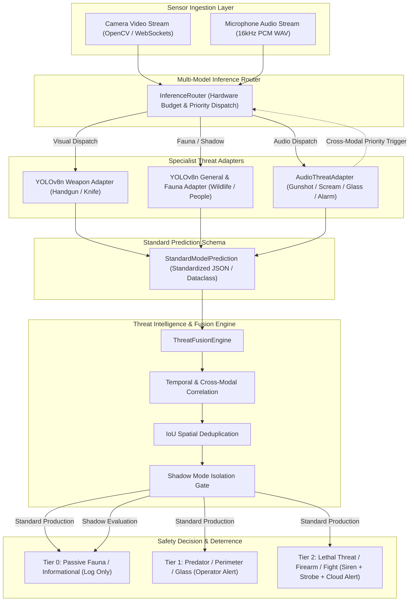

# AWARESPAN Multi-Model Intelligence Architecture

**Project:** AWARESPAN  
**Tagline:** Awareness Without Boundaries.  
**Official Problem Statement:** An AI-Powered Safety Device.  
**Contact:** awarespan@bchbenjamin.in  
**Architecture Version:** `2.0.0`  

---

## 1. Architectural Principles

AWARESPAN has evolved from a single-model weapon detector prototype into an extensible, multi-model threat intelligence platform. The architecture adheres to five core design principles:

1. **Framework-Agnostic Model Adapters**: The central threat engine does not depend on a specific ML framework. Specialist models (PyTorch, Ultralytics, Keras, ONNX Runtime, TFLite) are encapsulated behind the standard [`ThreatModelAdapter`](file:///mnt/WindowsDrive/Shared/Projects/SIP/node-backend/ml_pipeline/adapters/base.py) contract.
2. **Common Standard Prediction Schema**: All specialist models emit predictions in a unified [`StandardModelPrediction`](file:///mnt/WindowsDrive/Shared/Projects/SIP/node-backend/ml_pipeline/schema/predictions.py) schema, supporting spatial bounding boxes, acoustic frequency profiles, and temporal durations.
3. **Decoupled Threat Intelligence & Multi-Modal Fusion**: Raw model outputs are never overwritten. A dedicated [`ThreatFusionEngine`](file:///mnt/WindowsDrive/Shared/Projects/SIP/node-backend/ml_pipeline/fusion/threat_fusion.py) correlates evidence across modalities (e.g., visual firearm + acoustic gunshot) over a sliding temporal window using calibrated probability combination.
4. **Hardware-Budgeted Edge Routing**: The [`InferenceRouter`](file:///mnt/WindowsDrive/Shared/Projects/SIP/node-backend/ml_pipeline/inference/router.py) enforces concurrency limits on edge hardware (Raspberry Pi 5) to prevent CPU and memory exhaustion, while supporting dynamic cross-modal triggers (e.g., audio screams elevate visual inspection priority).
5. **Zero Deterrence in Shadow Mode**: Candidate and experimental models can run in shadow evaluation mode without the capability to activate physical sirens or strobes.

---

## 2. Multi-Modal Pipeline Flow

---

## 3. Subsystem Breakdown

### 3.1 Taxonomy Subsystem (`ml_pipeline/taxonomy/`)
- Versioned JSON specification ([`taxonomy.json`](file:///mnt/WindowsDrive/Shared/Projects/SIP/node-backend/ml_pipeline/taxonomy/taxonomy.json)) defining stable dot-notation identifiers (`weapon.firearm.handgun`, `animal.wildlife.predator`, `audio.threat.gunshot`).
- [`TaxonomyManager`](file:///mnt/WindowsDrive/Shared/Projects/SIP/node-backend/ml_pipeline/taxonomy/taxonomy_manager.py) provides querying, filtering, and upstream label normalization.

### 3.2 Registry Subsystem (`ml_pipeline/registry/`)
- [`LocalModelRegistry`](file:///mnt/WindowsDrive/Shared/Projects/SIP/node-backend/ml_pipeline/registry/model_registry.py) tracking model lifecycle states:
  `DISCOVERED` ➔ `DOWNLOADED` ➔ `AUDITED` ➔ `LOADED` ➔ `EVALUATED` ➔ `APPROVED` ➔ `DEPLOYED` ➔ `DEPRECATED`.
- Versioned registry metadata stored in `models.json`.

### 3.3 Adapters Subsystem (`ml_pipeline/adapters/`)
- [`ThreatModelAdapter`](file:///mnt/WindowsDrive/Shared/Projects/SIP/node-backend/ml_pipeline/adapters/base.py): Base class defining `load()`, `predict()`, `metadata()`, `health_check()`.
- [`YOLOv8Adapter`](file:///mnt/WindowsDrive/Shared/Projects/SIP/node-backend/ml_pipeline/adapters/yolo_adapter.py): Real-time visual object detection with confidence filtering and bbox extraction.
- [`AudioThreatAdapter`](file:///mnt/WindowsDrive/Shared/Projects/SIP/node-backend/ml_pipeline/adapters/audio_adapter.py): Acoustic impulse shockwave and vocal scream classification.
- [`MockThreatAdapter`](file:///mnt/WindowsDrive/Shared/Projects/SIP/node-backend/ml_pipeline/adapters/mock_adapter.py): Deterministic testing and CI harness.

### 3.4 Inference Subsystem (`ml_pipeline/inference/`)
- [`InferenceRouter`](file:///mnt/WindowsDrive/Shared/Projects/SIP/node-backend/ml_pipeline/inference/router.py): Multi-model scheduling with hardware concurrency budgets.
- [`ModelBenchmarkRunner`](file:///mnt/WindowsDrive/Shared/Projects/SIP/node-backend/ml_pipeline/inference/benchmark.py): Measures latency, memory (RSS), and FPS.

### 3.5 Fusion Subsystem (`ml_pipeline/fusion/`)
- [`ThreatFusionEngine`](file:///mnt/WindowsDrive/Shared/Projects/SIP/node-backend/ml_pipeline/fusion/threat_fusion.py): Multi-modal cross-correlation, sliding-window temporal persistence, and IoU duplicate suppression.
- [`HumanFeedbackStore`](file:///mnt/WindowsDrive/Shared/Projects/SIP/node-backend/ml_pipeline/fusion/feedback.py): Logs operator confirmations and corrections without altering AI ground truth.

### 3.6 Packaging Subsystem (`ml_pipeline/packaging/`)
- [`ModelReleaseManager`](file:///mnt/WindowsDrive/Shared/Projects/SIP/node-backend/ml_pipeline/packaging/release_manager.py): Builds versioned release bundles (`awarespan-models-v0.1.0.zip`) containing `manifest.json`, `SHA256SUMS`, and verified redistributable weights.
