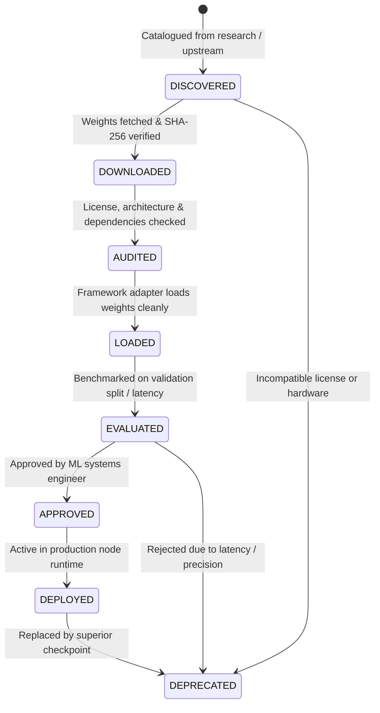

# AWARESPAN Model Registry & Lifecycle Management

**Project:** AWARESPAN  
**Tagline:** Awareness Without Boundaries.  
**Official Problem Statement:** An AI-Powered Safety Device.  
**Contact:** awarespan@bchbenjamin.in  

---

## 1. Overview

The AWARESPAN Local Model Registry tracks every machine learning model evaluated or deployed across edge nodes and training stations. It is distinct from the dataset registry: a dataset version represents training corpus provenance, whereas a model registry entry represents a trained, checksummed, audited artifact.

---

## 2. Model Lifecycle States

A model transitions through strict, traceable gates. An unverified model can never become a production model automatically.



---

## 3. Active Registry Inventory (v1.0.0)

| Model Identifier | Version | Framework | Supported Classes | State | SHA-256 Checksum |
| :--- | :---: | :--- | :--- | :---: | :--- |
| `awarespan-weapon-yolov8n` | 1.0.0 | `ultralytics_yolov8` | Handgun, Knife | **DEPLOYED** | `e817da6a6bd08861095bf456f10bbad19dc3eda46669282fc266ddc47dca3e34` |
| `awarespan-weapon-yolov8n-epoch80` | 1.0.0 | `ultralytics_yolov8` | Handgun, Knife | **APPROVED** | `ac06e9281a7f20208549e739b9b1dd4f20e426b209d12027ac9122d920c80c90` |
| `awarespan-general-yolov8n` | 1.0.0 | `ultralytics_yolov8` | Fauna, Knife, People | **EVALUATED** | `f59b3d833e2ff32e194b5bb8e08d211dc7c5bdf144b90d2c8412c47ccfc83b36` |
| `awarespan-yamnet-audio` | 1.0.0 | `yamnet_acoustic_dsp` | Gunshot, Scream, Glass, Alarm | **LOADED** | `13c3308955bbfaef262f175ac9c40e47b134573a93984f009220dd7cc12a1744` |

---

## 4. Local Model Storage Layout

```
models/
├── registry/
│   ├── models.json         # Versioned registry database
│   └── taxonomy.json       # Versioned taxonomy schema
├── working/                # Staged binary artifacts (git-ignored)
│   ├── weapon/
│   ├── animal/
│   ├── human_activity/
│   ├── audio/
│   └── environmental/
├── deployed/
│   └── manifest.json       # Active node deployment manifest
└── archive/                # Deprecated or superseded checkpoints
```

---

## 5. API Reference

The Python registry API is implemented in [`LocalModelRegistry`](file:///mnt/WindowsDrive/Shared/Projects/SIP/node-backend/ml_pipeline/registry/model_registry.py#L75-L175):
- `register_model(entry: ModelRegistryEntry) -> bool`
- `transition_state(model_id: str, version: str, target_state: ModelState, reason: str) -> bool`
- `get_model(model_id: str, version: Optional[str]) -> Optional[ModelRegistryEntry]`
- `list_models(modality=None, state=None, task=None) -> List[ModelRegistryEntry]`
- `get_deployed_models() -> List[ModelRegistryEntry]`
