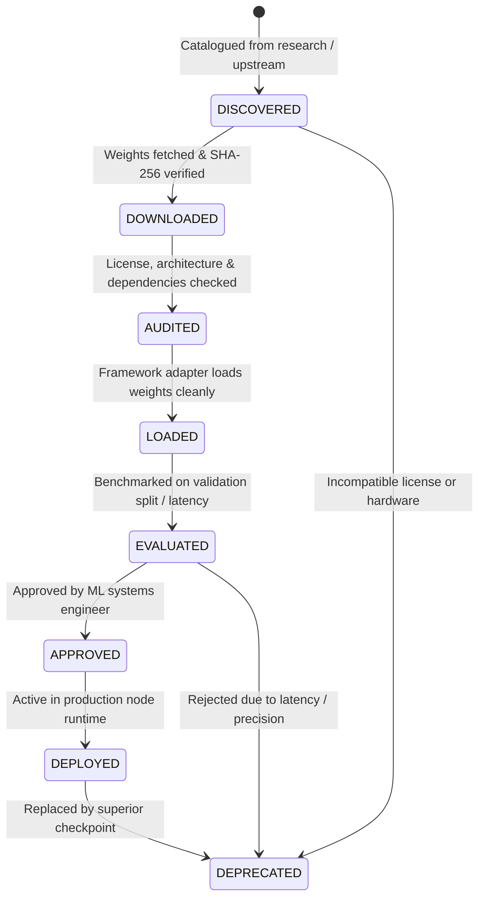

# AWARESPAN Model Registry & Lifecycle Management

**Project:** AWARESPAN
**Tagline:** Awareness Without Boundaries.
**Official Problem Statement:** An AI-Powered Safety Device.
**Contact:** awarespan@bchbenjamin.in

---

## 1. Overview

The AWARESPAN Local Model Registry tracks every machine learning model evaluated or deployed across edge nodes and training stations. It is distinct from the dataset registry: a dataset version represents training corpus provenance, whereas a model registry entry represents a trained, checksummed, audited artifact.

---

## 2. Model Lifecycle States

A model transitions through strict, traceable gates. An unverified model can never become a production model automatically.



---

## 3. Current Registry Inventory

The checked-in registry has two visual artifacts available locally and several candidates whose weights are not present. The Pi edge profile currently selects the weapon model and general COCO baseline. The latter is enabled as a provisional person/dog presence baseline and still needs field validation on the Pi camera.

| Model Identifier | Artifact | Classes / Task | Registry state | Runtime status |
| :--- | :--- | :--- | :---: | :--- |
| `awarespan-weapon-yolov8n` | `shared/models/yolov8n_best_weapon.pt` | Gun, knife | **DEPLOYED** | Selected in `pi5_edge` |
| `awarespan-general-yolov8n` | `shared/models/yolov8n.pt` | COCO person, dog (allow-listed) | **EVALUATED** | Provisional edge baseline; camera validation pending |
| `awarespan-weapon-yolov8n-epoch80` | `artifacts/model-checkpoints/recovered/epoch80_best_map.pt` | Gun, knife | **DISCOVERED** | Blocked: referenced file absent from checkout |
| `awarespan-yamnet-audio` | `models/working/audio/yamnet.h5` | Audio event classification | **DISCOVERED** | Disabled: weight file absent |

The runtime `AudioThreatAdapter` currently implements a rule-based spectral DSP baseline; it is not a loaded YAMNet neural network. The video temporal adapter is an extension contract only; no action-recognition weights are currently deployed.

See [`models/deployed/manifest.json`](../models/deployed/manifest.json) for model profiles and checksum validation. `pi5_edge` is the active local profile. `cloud_full` is a planning contract and cannot be selected for execution until a real cloud inference provider is implemented.

## 4. Local Model Storage Layout

```
models/
├── registry/
│   ├── models.json         # Versioned registry database
│   └── taxonomy.json       # Versioned taxonomy schema
├── working/                # Staged binary artifacts (git-ignored)
│   ├── weapon/
│   ├── animal/
│   ├── human_activity/
│   ├── audio/
│   └── environmental/
├── deployed/
│   └── manifest.json       # Active node deployment manifest
└── archive/                # Deprecated or superseded checkpoints
```

---

## 5. API Reference

The Python registry API is implemented in [`LocalModelRegistry`](../ml_pipeline/registry/model_registry.py):
- `register_model(entry: ModelRegistryEntry) -> bool`
- `transition_state(model_id: str, version: str, target_state: ModelState, reason: str) -> bool`
- `get_model(model_id: str, version: Optional[str]) -> Optional[ModelRegistryEntry]`
- `list_models(modality=None, state=None, task=None) -> List[ModelRegistryEntry]`
- `get_deployed_models() -> List[ModelRegistryEntry]`
